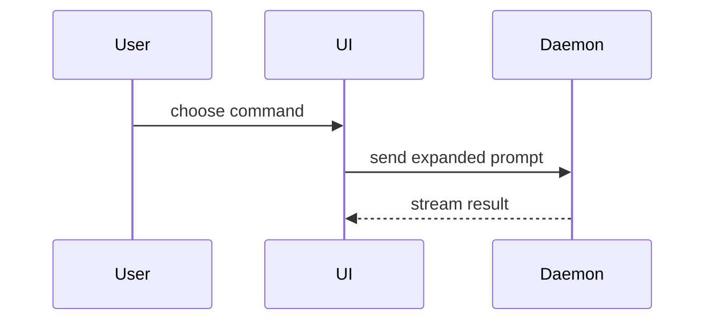

## Downstream

This is a forked skill borrowing from a public repository. Use /downstream to track forked changes.

# Open a PR

**Worktree.** Work from a git worktree off main. Multiple `Task` calls on the same branch each get their own worktree, or `git fetch && git reset --hard origin/<branch>` between them. Dirty branch with unrelated work: patch out, fresh worktree, apply. Snarled worktree: reset from main, redo minimally.

**Commits.** Commit liberally. Rebase into small, ordered commits before opening PRs. Each commit is a future PR: landable, ordered to tell the story. Amend when the fix belongs in a just-made commit. New commit when separable. Commit bodies don't restate the subject.

**PRs.** Run /deslop-code over the diff before commit and `/no-comments` before review. Write every PR title, description, and commit body with `/technical-writing` (apply the STE vocabulary rules: one word per action, keep articles, a plain verb over `-ing` where one works), then apply `/unslop-prose`.

**Titles.** Conventional Commits `type(scope): subject`, no trailing period. Type such as `feat`, `fix`, `docs`, `refactor`, `test`, `chore`, or `perf`. Scope is the area, project, or epic name, such as `Knowledge Vault` or `Math Tutor UI`. Subject is short, imperative, and names a real symbol when one carries the change, for example `fix(Knowledge Vault): retarget opening-a-pr babysit trigger`.

**Descriptions.** The PR body is a one-minute briefing, not a lab notebook, for a reviewer who has the diff. It says why the change exists, what it leaves out, what it could break, and how you proved it works. Write short, simple sentences with few identifiers, no walls of text. The body becomes the squash commit body, so keep that commit under about 40 lines. Use `##` headings, not bold lead-ins, in this order, and drop a section with nothing to say:

- `## Why`: the problem and approach, 1–3 short sentences. No SHAs, rebase genealogy, or "based on main" preamble.
- `## What changed`: 1–3 short bullets. Name a real symbol or path only when it carries the change. Name both sides of a rename or retarget. Use **Visual Aids** where appropriate
- `## Scope`: always. 1–3 short items on what it covers and what it deliberately leaves out (a follow-up, a known gap). No symbols, paths, or file-by-file essay.
- `## Tradeoffs`: only rejected alternatives a reviewer would otherwise ask about. Skip when there was no real choice.
- `## Blast Radius`: 1–2 sentences on who or what it touches and why that is safe or risky.
- `## Verification`: 1–3 bullets, each a real verification path and its outcome. Perf: one primary number with its unit, `before → after`.
- `## Evidence`: Before/After <screenshot/output/failing test run>. Concrete evidence that the change works. Show a before and after. Screenshots are S-tier - when the environment is set up for it and the change is visual. Execution-based evidence is A-tier. Test results, console output. Show the exact test that now fails and passes, using pseudocode.

After the sections, attach videos or screenshots when they prove a claim. Full SHAs, lever-correction essays, file-by-file checklists, and "CLEAN" verdicts go in a linked artifact, not the body.

**Size and stacks.** Prefer five narrow PRs to one large PR. A stack is a base-branch chain. The root PR targets trunk. Each child branch rebases onto its parent's exact tip and its PR targets the parent branch. Create a child with `origin pr create --status open --base <parent-branch>` or `gh pr create --base <parent-branch>`, and retarget one with `origin pr edit <pr> --base <parent-branch>` or `gh pr edit <pr> --base <parent-branch>`. Branch from trunk only for independent work. Rebase on trunk before substantial stack work.

**Readiness.** Open every PR ready, never as a draft. A built-in PR tool can default to draft, so set `draft: false` on every creation call. With `gh`, omit `--draft`. If a PR still opens as a draft, mark it ready `gh pr ready <number>`. Run gh pr view <number>` before you refer to PR status.

**Visual Aids**
Pick the smallest view that makes the key point clear.

<diagram, diff-sketch, or tree>

- Show logic or an algorithm as pseudocode:

```text
on(save)
  if content is unchanged
    return cached result
  write new content
  return fresh result
```

- Show runtime control flow as a call tree:

```text
submitForm
  createSession
    persistPrompt
    launchAgent
  navigateToSession
```

- Show UI structure as a component tree, including state and module boundaries that matter:

```text
<SessionPage> (apps/example/src/routes/session.tsx)
  useSessionEvents()
  <SessionToolbar>
    <RunSkillButton> (packages/ui)
```

- Show file responsibility or a broad refactor as a shallow file tree:

```text
src/
├── commands/       # parses user actions
├── sessions/       # owns session state
└── transport/      # sends API requests
```

- Show component interaction, control flow, or data flow with Mermaid:



- Use `diff` when the point is what changes and the surrounding shape already exists. Match the diff shape to the topic.

For a component change:

```diff
 <SessionPage>
   useSessionEvents()
   <SessionToolbar>
+    <RunSkillButton />
   <SessionTimeline>
+    <SkillResultCard />
```

For a file-layout change:

```diff
 src/
 ├── commands/
+│   └── show-me.ts       # expands the slash command
 ├── sessions/
-└── transport.ts
+└── transport/
+    ├── client.ts
+    └── stream.ts
```

For a call-tree or call-stack change:

```diff
 submitForm
   createSession
     persistPrompt
+    expandSkillMention
     launchAgent
-  navigateToSession
+  navigateToSession
+    subscribeToEvents
```

For a state or control-flow change:

```diff
 on(save)
-  write content
+  if content is unchanged
+    return cached result
+  write new content
+  invalidate cache
```

- Show the whole block when most of it is new, when omitted context would hide ownership or order, or when the user needs a copyable target shape:

```ts
function expandSkill(command: string): string {
  const skillName = command.slice(1);
  return `use the ${skillName} skill`;
}
```
